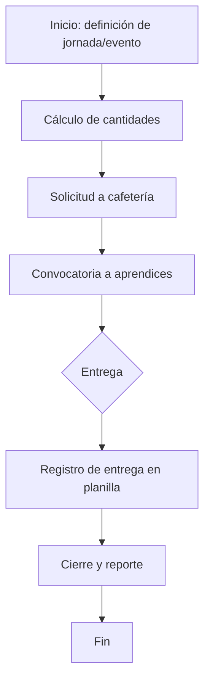

# AS-IS — Procesos actuales (Refrigerios y Portátiles)

**Propósito:** describir el proceso actual tal como es, con sus cuellos de botella, para justificar el TO-BE.

---

## 1. Proceso actual de refrigerios

### 1.1 Descripción narrativa

_(Completar con los hallazgos de entrevistas y observación)_

- Disparador del proceso:
- Pasos actuales (numerados):
- Actores por paso:
- Herramientas por paso:

### 1.2 Diagrama de flujo (Mermaid)

_(Ajustar según lo observado; agregar decisiones y reprocesos reales.)_

### 1.3 Puntos de dolor

| # | Punto de dolor | Evidencia | Impacto (frecuencia × severidad) |
|---|---|---|---|
| 1 | | | |
| 2 | | | |
| 3 | | | |

### 1.4 Reprocesos identificados

| Reproceso | Causa raíz | Costo estimado (tiempo) |
|---|---|---|
| | | |

---

## 2. Proceso actual de registro de portátiles (diagnóstico)

### 2.1 Descripción narrativa

_(Completar)_

### 2.2 Puntos de dolor

| # | Punto de dolor | Evidencia |
|---|---|---|
| 1 | | |

---

## 3. Oportunidades de mejora (insumos para requisitos)

| Oportunidad | Módulo impactado (M1–M11) | Requisito preliminar |
|---|---|---|
| | | |

## 4. Validación

- Validado con: _(nombre y cargo)_
- Fecha:
- Observaciones:
