# Diagrama de Casos de Uso (PT-DCU-01) — BienestarPro (Borrador v0.1)

**Estado:** Borrador v0.1 — derivado de `02-casos-de-uso.md` (36 CU) y del ERS v0.1. Pendiente de validación con las sesiones de discovery (Fase 0).

**Fecha:** 2026-10-09

**Propósito:** documentar gráficamente los casos de uso del piloto de BienestarPro, sus actores y sus relaciones, como entregable PT-DCU-01 de la Fase 1.

**Convenciones (SENA):**

- Actores en sustantivo singular.
- Casos de uso en verbo + sustantivo (nombres exactos del archivo de CU).
- Relaciones `<<include>>` (el caso base siempre ejecuta el incluido) y `<<extend>>` (comportamiento opcional), direccionales y justificadas en la sección 4.
- Agrupación por módulos M1–M11 (solo los 9 módulos del piloto).

**Totales:** 36 casos de uso, 8 actores, 5 relaciones `<<include>>`, 1 relación `<<extend>>`.

**Actores del piloto:**

| Actor | Tipo | Descripción |
|---|---|---|
| Usuario | Humano | Cualquier usuario con sesión activa (CU-01, CU-05, CU-20) |
| Superadmin | Humano | Administración global del sistema (CU-02, CU-03, CU-04) |
| Coordinación Bienestar | Humano | Rol operativo principal del área |
| Auxiliar Bienestar | Humano | Operación de entregas y cupos |
| Instructor | Humano | Director o instructor de ficha |
| Aprendiz | Humano | Usuario final destinatario de los beneficios |
| Cafetería | Humano | Preparación de refrigerios |
| Sistema | Sistema | Actor de sistema (procesos automáticos y temporizados) |

---

## 1. Diagrama general

El diagrama siguiente es la vista completa del sistema (36 CU y 8 actores). Por su tamaño excede el límite del renderizado automático, así que también se entrega dividido en dos vistas equivalentes: 1.1 Operación y 1.2 Comunicación y servicios, que son las versiones de trabajo para impresión y evidencia.

```plantuml
@startuml dcu-general
left to right direction
skinparam packageStyle rectangle
skinparam defaultTextAlignment center
title DCU-01 — Vista general: BienestarPro (36 CU en 9 módulos del piloto)

actor "Usuario" as U
actor "Superadmin" as SA
actor "Coordinación\nBienestar" as CB
actor "Auxiliar\nBienestar" as AB
actor "Instructor" as INS
actor "Aprendiz" as APR
actor "Cafetería" as CAF
actor "Sistema" as SIS

package "M4 Administración" {
  usecase "CU-01\nIniciar sesión" as CU01
  usecase "CU-02\nGestionar usuarios y roles" as CU02
  usecase "CU-03\nAdministrar centros" as CU03
  usecase "CU-04\nConsultar auditoría" as CU04
  usecase "CU-05\nConfigurar segundo factor" as CU05
}

package "M9 Fichas por jornada" {
  usecase "CU-06\nGestionar programas y fichas" as CU06
  usecase "CU-07\nGestionar aprendices e instructores" as CU07
  usecase "CU-08\nConsultar directorio de fichas" as CU08
  usecase "CU-09\nGestionar consentimientos" as CU09
}

package "M1 Refrigerios" {
  usecase "CU-10\nCrear evento de refrigerio" as CU10
  usecase "CU-11\nConvocar aprendices" as CU11
  usecase "CU-12\nConfirmar asistencia" as CU12
  usecase "CU-13\nAjustar cupos" as CU13
  usecase "CU-14\nRegistrar entrega de refrigerio" as CU14
  usecase "CU-15\nGenerar consolidado para cafetería" as CU15
  usecase "CU-16\nCerrar evento de refrigerio" as CU16
  usecase "CU-17\nConsultar historial de entregas" as CU17
}

package "M2 Notificaciones" {
  usecase "CU-18\nEnviar notificación multicanal" as CU18
  usecase "CU-19\nGestionar plantillas de mensajes" as CU19
  usecase "CU-20\nConfigurar preferencias de notificación" as CU20
  usecase "CU-21\nConsultar acuses de entrega" as CU21
  usecase "CU-22\nProgramar recordatorios de evento" as CU22
}

package "M10 Contactos de emergencia" {
  usecase "CU-23\nRegistrar contactos de emergencia" as CU23
  usecase "CU-24\nConsultar contactos de emergencia" as CU24
}

package "M6 Noticias y campañas" {
  usecase "CU-25\nPublicar noticia o campaña" as CU25
  usecase "CU-26\nConsultar analítica de campañas" as CU26
}

package "M7 Encuestas" {
  usecase "CU-27\nCrear encuesta" as CU27
  usecase "CU-28\nAplicar encuesta" as CU28
  usecase "CU-29\nConsultar resultados de encuesta" as CU29
}

package "M8 Reuniones y agenda" {
  usecase "CU-30\nAgendar reunión" as CU30
  usecase "CU-31\nGestionar confirmaciones de reunión" as CU31
  usecase "CU-32\nEnviar recordatorios de reunión" as CU32
  usecase "CU-33\nRegistrar acta de reunión" as CU33
}

package "M5 Informes" {
  usecase "CU-34\nGenerar planilla de entrega exportable" as CU34
  usecase "CU-35\nGenerar informe consolidado periódico" as CU35
  usecase "CU-36\nConsultar tablero de indicadores" as CU36
}

U --> CU01
U --> CU05
U --> CU20
SA --> CU02
SA --> CU03
SA --> CU04
CB --> CU06
CB --> CU07
CB --> CU09
CB --> CU10
CB --> CU16
CB --> CU19
CB --> CU21
CB --> CU22
CB --> CU23
CB --> CU24
CB --> CU25
CB --> CU26
CB --> CU27
CB --> CU29
CB --> CU30
CB --> CU33
CB --> CU34
CB --> CU35
CB --> CU36
AB --> CU13
AB --> CU14
INS --> CU08
INS --> CU31
APR --> CU12
APR --> CU17
APR --> CU28
CAF --> CU15
SIS --> CU11
SIS --> CU18
SIS --> CU32

CU11 ..> CU18 : <<include>>
CU22 ..> CU18 : <<include>>
CU25 ..> CU18 : <<include>>
CU30 ..> CU18 : <<include>>
CU32 ..> CU18 : <<include>>
CU13 ..> CU10 : <<extend>>

@enduml
```

---

### 1.1 Vista general A — Operación (M4, M9, M1)

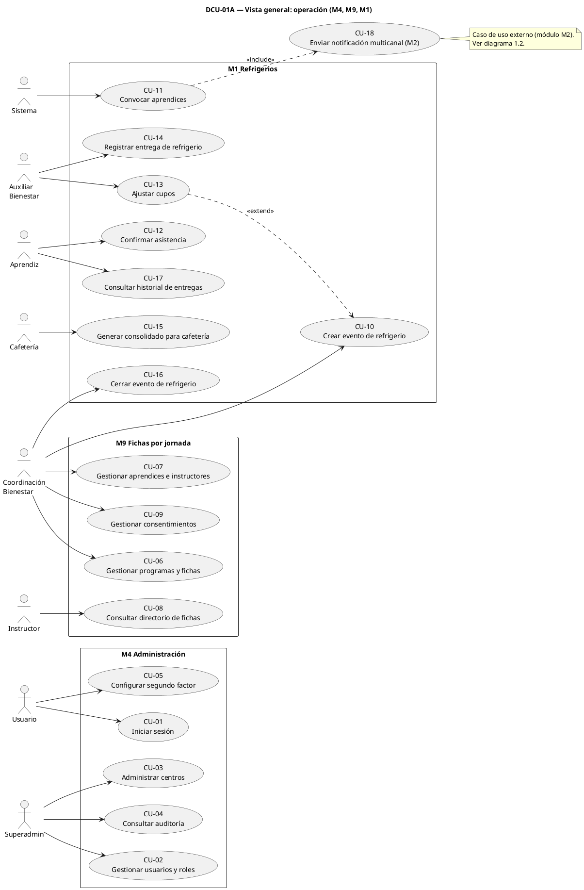

### 1.2 Vista general B — Comunicación y servicios (M2, M10, M6, M7, M8, M5)

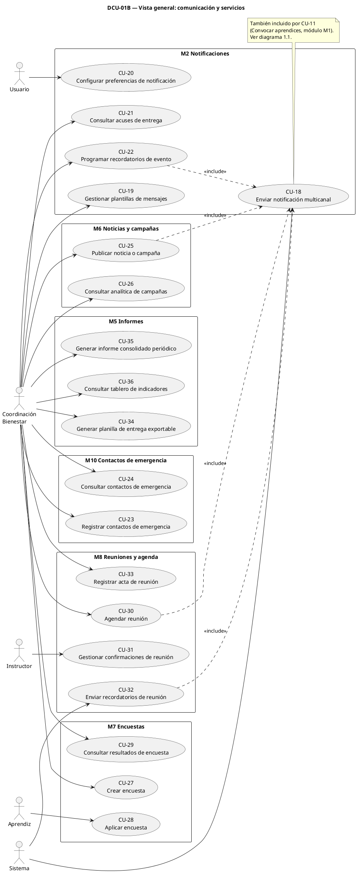

---

## 2. Diagramas por módulo

### 2.1 M4 Administración

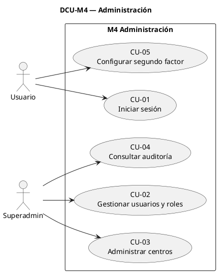

### 2.2 M9 Fichas por jornada

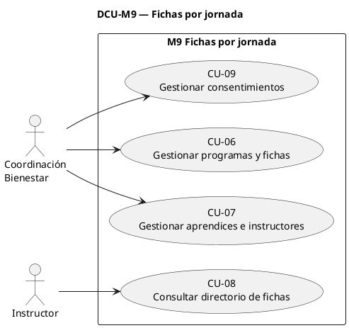

### 2.3 M1 Refrigerios

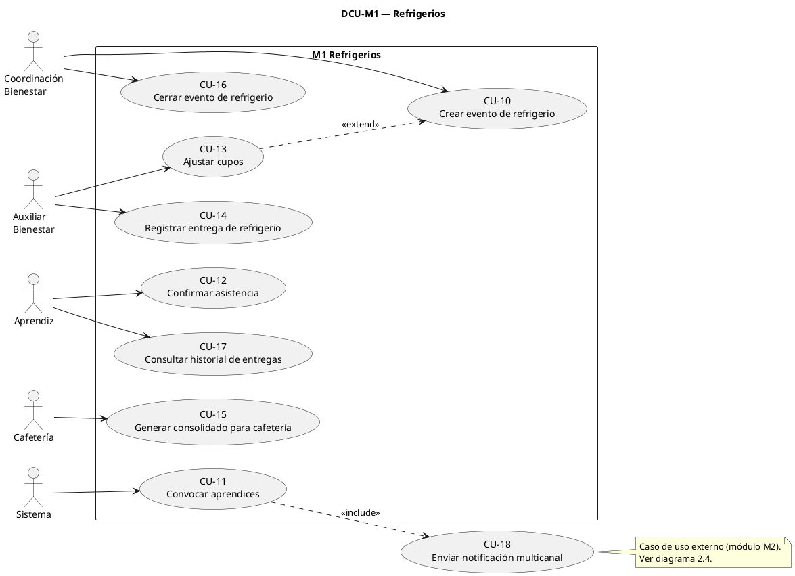

### 2.4 M2 Notificaciones

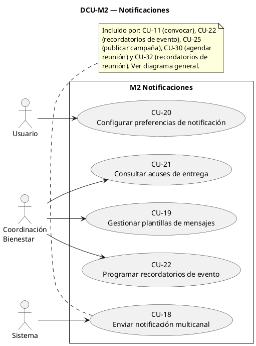

### 2.5 M10 Contactos de emergencia

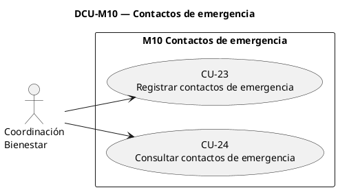

### 2.6 M6 Noticias y campañas

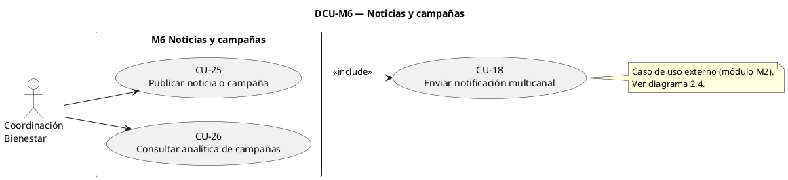

### 2.7 M7 Encuestas

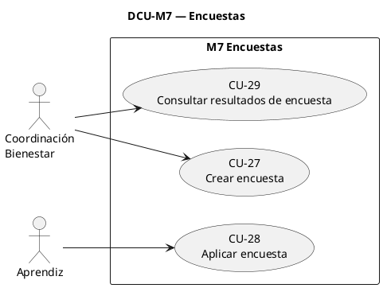

### 2.8 M8 Reuniones y agenda

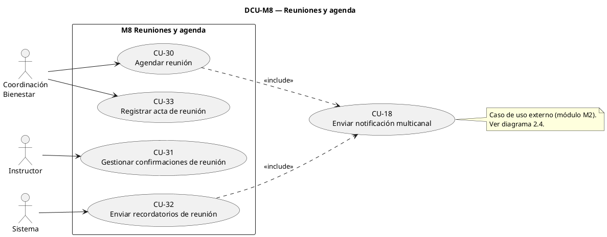

### 2.9 M5 Informes

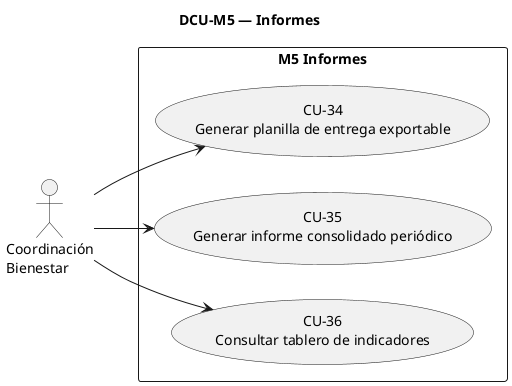

---

## 3. Trazabilidad actor a CU

| Actor | Casos de uso | Cantidad |
|---|---|---|
| Usuario | CU-01, CU-05, CU-20 | 3 |
| Superadmin | CU-02, CU-03, CU-04 | 3 |
| Coordinación Bienestar | CU-06, CU-07, CU-09, CU-10, CU-16, CU-19, CU-21, CU-22, CU-23, CU-24, CU-25, CU-26, CU-27, CU-29, CU-30, CU-33, CU-34, CU-35, CU-36 | 19 |
| Auxiliar Bienestar | CU-13, CU-14 | 2 |
| Instructor | CU-08, CU-31 | 2 |
| Aprendiz | CU-12, CU-17, CU-28 | 3 |
| Cafetería | CU-15 | 1 |
| Sistema | CU-11, CU-18, CU-32 | 3 |
| **Total** | | **36** |

## 4. Relaciones include y extend (con justificación)

| Relación | Tipo | Justificación (fuente: `02-casos-de-uso.md`) |
|---|---|---|
| CU-11 Convocar aprendices → CU-18 Enviar notificación multicanal | <<include>> | Paso 3 del flujo: el sistema envía la convocatoria por el hub de notificaciones; el envío siempre ocurre. |
| CU-22 Programar recordatorios de evento → CU-18 | <<include>> | Paso 4 del flujo: el recordatorio se envía por el hub de notificaciones. |
| CU-25 Publicar noticia o campaña → CU-18 | <<include>> | Paso 5 del flujo: el sistema notifica al segmento según las reglas del hub. |
| CU-30 Agendar reunión → CU-18 | <<include>> | Paso 4 del flujo: el sistema notifica a los convocados. |
| CU-32 Enviar recordatorios de reunión → CU-18 | <<include>> | Paso 3 del flujo: el recordatorio se envía por el hub de notificaciones. |
| CU-13 Ajustar cupos → CU-10 Crear evento de refrigerio | <<extend>> | Flujo alterno FA-2 de CU-10: el ajuste de cupos es opcional y se ejecuta antes de publicar el evento. |

**Lectura:** el hub de notificaciones (CU-18) es el caso de uso más reutilizado del sistema (5 inclusiones), lo que confirma su centralidad en arquitectura (hub multicanal).

## 5. Renderizado

**Artefactos generados** (en `docs/01-requisitos/assets/`):

| Archivo | Contenido |
|---|---|
| `dcu-general.puml` / `dcu-general.svg` | Vista completa (36 CU y 8 actores) |
| `dcu-general-a.puml` / `dcu-general-a.svg` | Vista general A: operación |
| `dcu-general-b.puml` / `dcu-general-b.svg` | Vista general B: comunicación y servicios |
| `dcu-m4.puml` … `dcu-m5.puml` | Código PlantUML de cada módulo |
| `dcu-m4.svg` … `dcu-m5.svg` | Diagramas renderizados por módulo |

**Estado del renderizado:** los 12 diagramas están renderizados en SVG, listos para evidencia SENA. Las tres vistas generales (completa, A y B) se renderizaron con el servidor público de PlantUML (plantuml.com) porque exceden el límite de tamaño del servicio Kroki; los nueve diagramas por módulo se renderizaron con Kroki. Además de los SVG, en `assets/` quedan los fuentes `.puml` de los 12 diagramas (fuente de verdad editable).

**Render local (recomendado):** quedó instalado el jar de PlantUML 1.2026.8 en `~/.local/share/plantuml/plantuml.jar`. El render local requiere Graphviz (`dot`), que no está instalado en el entorno (no se pudo instalar por permisos). Una vez instalado con `sudo apt install graphviz`:

```
java -jar ~/.local/share/plantuml/plantuml.jar docs/01-requisitos/04-diagrama-casos-de-uso.md -tsvg -o docs/01-requisitos/assets
```

## Registro de cambios

| Versión | Fecha | Cambio |
|---|---|---|
| 0.1 | 2026-10-09 | Creación del borrador a partir de los CU y el ERS v0.1 |
