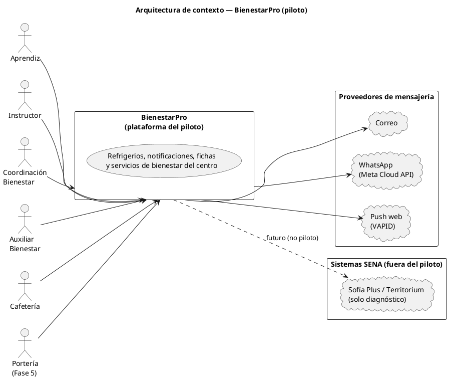
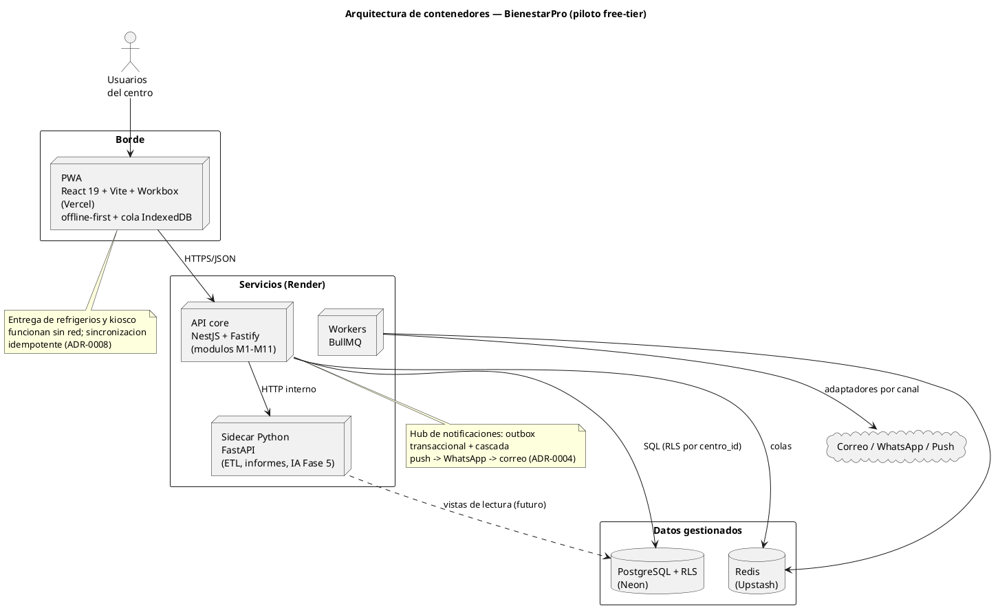

# Arquitectura de Referencia — BienestarPro (Borrador v0.1)

**Estado:** Borrador v0.1 — Fase 2 (arquitectura). Consolida las decisiones de los ADRs 0002 a 0008, 0011 y 0013.

**Fecha:** 2026-10-09

**Propósito:** dar la vista de conjunto del sistema (contexto y contenedores), enlazar los artefactos de arquitectura y dejar explícitas las rutas transversales.

---

## 1. Visión general

**Regla de oro:** que la información correcta llegue a la persona correcta en el momento correcto, sin que nadie tenga que recordárselo.

El piloto cubre los módulos M4 (Administración), M9 (Fichas), M1 (Refrigerios), M2 (Notificaciones), M10 (Contactos de emergencia), M6 (Noticias), M7 (Encuestas), M8 (Reuniones) y M5 (Informes). M3 (Portátiles) y M11 (IA/RAG) quedan para la Fase 5 (ADR-0013).

**Restricciones de diseño que explican la arquitectura:**

1. Costo casi nulo en el piloto (capas gratuitas; ADR-0007).
2. Equipo semillero pequeño (monolito modular antes que microservicios; ADR-0002).
3. Usuarios con baja alfabetización digital (PWA simple, offline-first; ADR-0008).
4. Ley 1581 de 2012 y datos de menores (RLS, auditoría, anonimato; ADR-0003 y ADR-0011).
5. Multi-centro desde el día 1 (replicación nacional; ADR-0003).

## 2. Diagrama de contexto

## 3. Diagrama de contenedores

## 4. Estilo arquitectónico

- **Monolito modular por dominios** (NestJS) + **sidecar Python** para datos e IA (ADR-0002).
- **Multi-tenant por fila** con RLS en PostgreSQL (ADR-0003).
- **Hub de notificaciones** con outbox + BullMQ + adaptadores (ADR-0004); automatización 100% en código (ADR-0005).
- **Identidad propia** con puerto de federación y TOTP en roles sensibles (ADR-0006).
- **PWA offline-first** con idempotencia por UUID de cliente (ADR-0008).
- **Piloto en capas gratuitas** con criterios de migración a VPS (ADR-0007).

## 5. Mapa de módulos

| Módulo | Contexto | Fase |
|---|---|---|
| M4 Administración | Identidad, RBAC/ABAC, centros, auditoría | Piloto |
| M9 Fichas por jornada | Programas, fichas, aprendices, instructores, consentimientos | Piloto |
| M1 Refrigerios | Eventos, cupos, convocatoria, entrega QR, cierre | Piloto |
| M2 Notificaciones | Hub multicanal, plantillas, preferencias, acuses | Piloto |
| M10 Contactos de emergencia | Directorio restringido con auditoría | Piloto |
| M6 Noticias y campañas | Publicación segmentada, analítica agregada | Piloto |
| M7 Encuestas | Encuestas con anonimato por diseño | Piloto |
| M8 Reuniones y agenda | Agenda, RSVP, actas | Piloto |
| M5 Informes | Planillas, informes, tablero | Piloto (cierre) |
| M3 Portátiles | Kiosco de portería, visitantes | Fase 5 |
| M11 IA/RAG | Asistente sobre normativa, clasificación de mensajes | Fase 5 |

## 6. Rutas transversales

1. **Notificaciones:** todo aviso pasa por el hub (ADR-0004); la convocatoria, recordatorios y campañas lo reutilizan.
2. **Aislamiento:** toda consulta y escritura pasa por el contexto de centro + RLS (ADR-0003).
3. **Auditoría:** acciones críticas y lecturas de datos sensibles en bitácora de solo inserción (threat model §5).
4. **Offline:** operaciones críticas con cola local + UUID de cliente; el servidor es idempotente (ADR-0008).
5. **Privacidad:** minimización, anonimato por diseño en encuestas, exportables sin contactos de emergencia (ADR-0011).

## 7. Estructura del repositorio

| Ruta | Contenido |
|---|---|
| `apps/` | Aplicaciones (PWA, API, sidecar) |
| `packages/contracts` | Superficie pública de la API y tipos compartidos (no romper sin actualizar) |
| `infra/` | Despliegue (incluye el motor de investigación, herramienta interna) |
| `docs/00-discovery` … `docs/03-ux` | Artefactos por fase |

## 8. Artefactos relacionados

- Diagramas: `docs/02-arquitectura/assets/` (fuente `.puml` y SVG renderizado de contexto y contenedores).
- Decisiones: `docs/adr/` (ADR-0002 a 0008, 0011, 0013 y 0014).
- Requisitos: `docs/01-requisitos/01-ers-borrador-v0.1.md`, `02-casos-de-uso.md`, `03-historias-usuario.md`, `04-diagrama-casos-de-uso.md`.
- Datos: `docs/02-arquitectura/01-modelo-datos.md`.
- Seguridad: `docs/02-arquitectura/03-threat-model.md`.
- Herramienta interna de investigación (no es el producto): `docs/02-arquitectura/open-notebook-motor-investigacion.md`.

## Registro de cambios

| Versión | Fecha | Cambio |
|---|---|---|
| 0.1 | 2026-10-09 | Creación en Fase 2 (arquitectura) |
