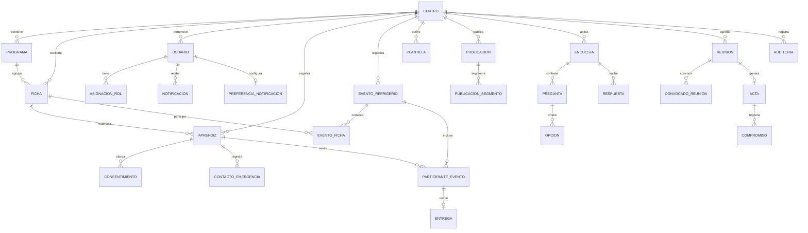

# Modelo de Datos — BienestarPro (Borrador v0.1)

**Estado:** Borrador v0.1 — Fase 2 (arquitectura). Pendiente de validación con el discovery y de refinamiento en la implementación.

**Fecha:** 2026-10-09

**Decisiones que lo gobiernan:** ADR-0003 (PostgreSQL + RLS multi-tenant), ADR-0011 (datos sensibles), ADR-0004 (outbox de notificaciones), ADR-0008 (idempotencia offline).

---

## 1. Principios de diseño

1. **Multi-tenant por fila:** toda tabla de negocio incluye `centro_id`; el aislamiento se aplica con Row-Level Security (RLS), no solo en la aplicación.
2. **Minimización (Ley 1581):** solo se almacena lo necesario para la finalidad declarada; los datos de desarrollo son sintéticos.
3. **Auditoría como ciudadano de primera clase:** acciones críticas y lecturas de datos sensibles quedan en una bitácora de solo inserción.
4. **Idempotencia:** las operaciones que pueden repetirse desde el cliente offline llevan `uuid_cliente` (unicidad por operación).
5. **Historial sin reescritura:** las versiones (plantillas, consentimientos, actas) se conservan; nada crítico se actualiza "en sitio" sin rastro.
6. **Identificadores:** claves primarias UUID v7 (ordenables por tiempo); claves de negocio (documento de aprendiz) únicas por centro.

## 2. Diagrama entidad-relación (vista núcleo)



## 3. Entidades por contexto

### 3.1 Identidad y acceso (M4)

| Entidad | Campos clave | Notas |
|---|---|---|
| `centro` | id, nombre, regional, estado | El tenant raíz. |
| `usuario` | id, centro_id (nulo para superadmin), documento, correo, password_hash (Argon2id), totp_secret (cifrado), estado | Login con documento o correo (ADR-0006). |
| `asignacion_rol` | id, usuario_id, rol, ambito_tipo (centro/programa/ficha), ambito_id, vigente_desde/hasta | RBAC + ABAC por ámbito. |
| `auditoria` | id, centro_id, usuario_id, entidad, entidad_id, accion, datos (json), fecha | **Solo inserción** (sin UPDATE ni DELETE para la aplicación). |

### 3.2 Fichas y personas (M9)

| Entidad | Campos clave | Notas |
|---|---|---|
| `programa` | id, centro_id, nombre, estado | Catálogo del centro. |
| `ficha` | id, centro_id, programa_id, codigo, jornada (manana/tarde/noche), fecha_inicio, fecha_fin, estado | Jornada como enumeración. |
| `aprendiz` | id, centro_id, documento, nombres, correo, ficha_id, estado, fecha_retiro | Único (centro_id, documento). Historial conservado tras el retiro. |
| `instructor_ficha` | id, centro_id, usuario_id, ficha_id, rol_ficha (director/instructor) | Relación N:M. |
| `consentimiento` | id, centro_id, aprendiz_id, version_aviso, fecha_otorgado, estado (vigente/revocado), revocado_en | Versionado y revocable (ADR-0011 D3). |

### 3.3 Refrigerios (M1)

| Entidad | Campos clave | Notas |
|---|---|---|
| `evento_refrigerio` | id, centro_id, fecha, jornada, estado (borrador/activo/cerrado), reglas_snapshot (json), cerrado_en | `reglas_snapshot` congela el cálculo de cupos aplicado. |
| `evento_ficha` | evento_id, ficha_id, cupos_calculados, cupos_ajustados | Puente evento-ficha. |
| `participante_evento` | id, evento_id, aprendiz_id, estado (convocado/confirmado/rechazado/entregado/no_reclamado), uuid_qr, confirmado_en | `uuid_qr` único por evento (anti-repetición, T-01). |
| `entrega` | id, participante_id, fecha_hora, metodo (qr/manual), registrado_por, uuid_cliente (único), motivo_manual, dispositivo | `uuid_cliente` garantiza idempotencia offline (ADR-0008 D3). |
| `ajuste_cupo` | id, evento_ficha_id, valor_anterior, valor_nuevo, motivo, usuario_id, fecha | Auditado (RF-16). |

### 3.4 Notificaciones (M2)

| Entidad | Campos clave | Notas |
|---|---|---|
| `plantilla` | id, centro_id, tipo, canal, version, contenido, variables, estado, publicada_en | Versionada (ADR-0004 D6). |
| `preferencia_notificacion` | usuario_id, canales (json), horario_silencioso_inicio/fin, actualizado_en | Una por usuario. |
| `outbox` | id, centro_id, tipo_evento, payload (json), estado (pendiente/publicado), creado_en | Escrita en la transacción del caso de uso (ADR-0004 D1). |
| `notificacion` | id, outbox_id, destinatario_id, canal_intentado, canal_efectivo, estado (sent/delivered/read/failed), plantilla_version, intentos, ultimo_error, fecha | Registro de acuses (RNF-10). |

### 3.5 Contactos de emergencia (M10)

| Entidad | Campos clave | Notas |
|---|---|---|
| `contacto_emergencia` | id, centro_id, aprendiz_id, nombre, parentesco, telefono | Acceso restringido + auditoría de lecturas (ADR-0011 D1). |

Las lecturas se registran en `auditoria` (accion `lectura_contacto`, entidad `aprendiz`); no se crea tabla aparte para mantener una sola bitácora.

### 3.6 Noticias y campañas (M6)

| Entidad | Campos clave | Notas |
|---|---|---|
| `publicacion` | id, centro_id, tipo (noticia/campana), titulo, contenido, estado (borrador/programada/publicada), publica_en, autor_id | Programación (RF-31). |
| `publicacion_segmento` | publicacion_id, segmento_tipo (programa/ficha/jornada), segmento_id | Alcance de la publicación. |
| `metrica_publicacion` | publicacion_id, dia, vistas, lecturas, clics | **Agregada por día**; no registra lectores individuales (privacidad por diseño). |

### 3.7 Encuestas (M7)

| Entidad | Campos clave | Notas |
|---|---|---|
| `encuesta` | id, centro_id, titulo, anonima (bool), estado (borrador/publicada/cerrada), publicada_en | La estructura se congela al publicar. |
| `pregunta` | id, encuesta_id, tipo (unica/multiple/escala), texto, orden, obligatoria | |
| `opcion` | id, pregunta_id, texto, orden | Para unica/multiple. |
| `respuesta` | id, encuesta_id, pregunta_id, opcion_id / valor_escala, **usuario_id (nulo si anónima)** | Prueba de anonimato: el modo anónimo no escribe usuario_id (ADR-0011 D2). |
| `segmento_encuesta` | encuesta_id, segmento_tipo, segmento_id | A quién se aplica. |

### 3.8 Reuniones y agenda (M8)

| Entidad | Campos clave | Notas |
|---|---|---|
| `reunion` | id, centro_id, titulo, fecha_hora, lugar, enlace, estado (programada/cancelada/realizada), organizador_id | |
| `convocado_reunion` | reunion_id, usuario_id, estado (pendiente/confirmado/rechazado) | RSVP (RF-37). |
| `acta` | id, reunion_id, contenido, publicada_en, versiones (json) | Historial de cambios (CU-33). |
| `compromiso` | id, acta_id, descripcion, responsable_id, fecha_limite, estado | Seguimiento. |

### 3.9 Informes (M5)

| Entidad | Campos clave | Notas |
|---|---|---|
| (sin entidades propias) | — | Los informes se derivan de eventos cerrados y entregas. Las **exportaciones** se registran en `auditoria` (accion `exportacion`). |

## 4. Estrategia RLS (multi-tenant)

```sql
-- Patrón por tabla multi-tenant (ejemplo):
ALTER TABLE evento_refrigerio ENABLE ROW LEVEL SECURITY;

CREATE POLICY tenant_isolation ON evento_refrigerio
  USING (centro_id = current_setting('app.centro_id')::uuid);

-- La aplicación establece el contexto al abrir la transacción:
-- SET LOCAL app.centro_id = '<uuid-del-centro>';
```

Reglas:

1. Toda tabla multi-tenant nace con `centro_id` y su política; el script de migración lo verifica.
2. El Superadmin usa un rol de base de datos dedicado con política explícita y auditada.
3. Pruebas automatizadas de aislamiento: desde el contexto del centro A, cero filas del centro B (RNF-07).
4. El usuario de aplicación no tiene permisos DDL ni DELETE sobre `auditoria` (solo INSERT).

## 5. Auditoría (qué se registra)

| Acción | Entidad | Datos adicionales |
|---|---|---|
| Acceso (login/logout, fallo, bloqueo) | usuario | IP, dispositivo |
| Cambio de roles/asignaciones | asignacion_rol | Diferencias |
| Ajuste de cupos | evento_ficha | Motivo, valores |
| Lectura de contactos de emergencia | aprendiz | Motivo declarado |
| Registro manual de entrega | entrega | Motivo |
| Exportaciones (planillas, informes) | — | Filtros, formato |
| Cierre de evento | evento_refrigerio | Resumen de cantidades |
| Cambios en encuestas publicadas | encuesta | (solo cambios permitidos) |

## 6. Índices y rendimiento clave

1. `centro_id` como primera columna de los índices compuestos multi-tenant.
2. Únicos de negocio: `(centro_id, documento)` en aprendiz; `uuid_cliente` en entrega; `uuid_qr` en participante_evento por evento.
3. Cola de notificaciones: índice por `outbox.estado` y fecha para el worker.
4. Agenda: índice por `(centro_id, fecha_hora)` en reunión.
5. Métricas de publicación: agregadas por día (no se indexan lectores individuales porque no existen).

## 7. Pendientes de confirmación (Fase 0 y diseño)

1. Reglas exactas de cupos por jornada/ficha (se reflejan en `reglas_snapshot`) — discovery.
2. Política de retención por entidad y borrado al retiro del aprendiz — ética SENNOVA (R-02 del threat model).
3. Decisión de cifrado a nivel de campo para `contacto_emergencia` — threat model (R-03).
4. Ventana de confirmación del evento (afecta `participante_evento.confirmado_en` y las reglas).
5. Formato de planilla actual (para los exportables de M5) — discovery.

## Registro de cambios

| Versión | Fecha | Cambio |
|---|---|---|
| 0.1 | 2026-10-09 | Creación en Fase 2 (arquitectura) |
